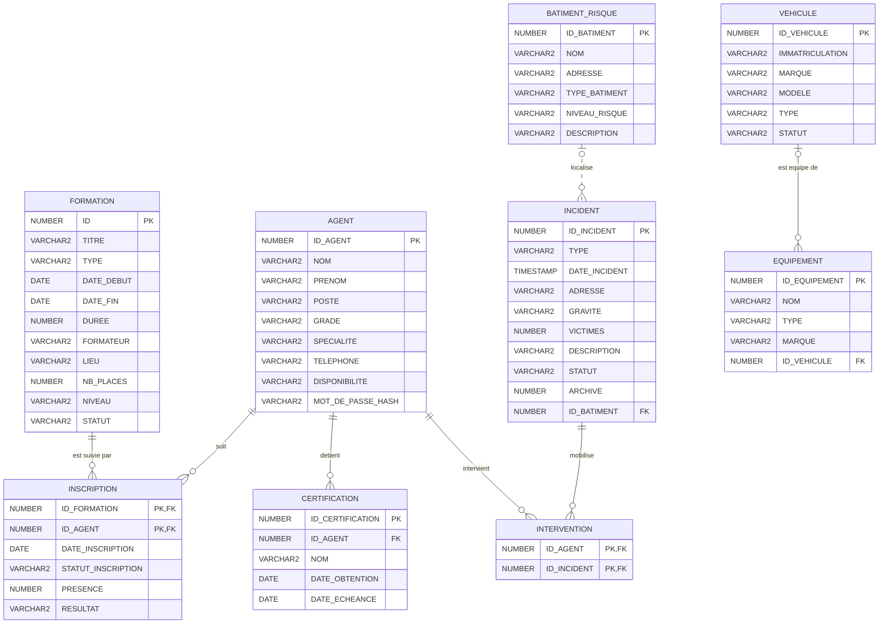

# Modèle de données commun Smart Fire Station

Le modèle ci-dessous reprend le diagramme fourni et les modules de données présents dans le dépôt. `INSCRIPTION` matérialise l'association plusieurs-à-plusieurs entre une formation et un agent. Les certifications sont séparées de `AGENT` pour permettre plusieurs certifications par agent. `INTERVENTION` matérialise le lien entre un agent et un incident. `EQUIPEMENT.ID_VEHICULE` matérialise l'affectation facultative d'un équipement à un véhicule.

## Modèle entité-association (MCD)



Les cardinalités `INTERVENIR` et `BATIMENT_RISQUE` sont déduites des modules du dépôt, car la capture coupe ces côtés du diagramme. Les attributs visibles de l'équipement sont `id_equipement`, `nom`, `type` et `marque`; les autres champs de véhicule/bâtiment sont des attributs minimaux retenus pour rendre les modules stockables. Les rapports sont produits à partir des données et n'ont pas de table dédiée.

## Modèle relationnel (MLD)

```text
FORMATION(ID PK, TITRE, TYPE, DATE_DEBUT, DATE_FIN, DUREE, FORMATEUR, LIEU,
          NB_PLACES, NIVEAU, STATUT)
AGENT(ID_AGENT PK, NOM, PRENOM, POSTE, GRADE, SPECIALITE, TELEPHONE,
      DISPONIBILITE, MOT_DE_PASSE_HASH)
INSCRIPTION(ID_FORMATION PK/FK -> FORMATION.ID,
            ID_AGENT PK/FK -> AGENT.ID_AGENT,
            DATE_INSCRIPTION, STATUT_INSCRIPTION, PRESENCE, RESULTAT)
CERTIFICATION(ID_CERTIFICATION PK, ID_AGENT FK -> AGENT.ID_AGENT,
              NOM, DATE_OBTENTION, DATE_ECHEANCE)
INCIDENT(ID_INCIDENT PK, TYPE, DATE_INCIDENT, ADRESSE, GRAVITE, VICTIMES,
         DESCRIPTION, STATUT, ARCHIVE, ID_BATIMENT FK -> BATIMENT_RISQUE.ID_BATIMENT)
INTERVENTION(ID_AGENT PK/FK -> AGENT.ID_AGENT,
             ID_INCIDENT PK/FK -> INCIDENT.ID_INCIDENT)
VEHICULE(ID_VEHICULE PK, IMMATRICULATION UQ, MARQUE, MODELE, TYPE, STATUT)
EQUIPEMENT(ID_EQUIPEMENT PK, NOM, TYPE, MARQUE,
           ID_VEHICULE FK -> VEHICULE.ID_VEHICULE NULL)
BATIMENT_RISQUE(ID_BATIMENT PK, NOM, ADRESSE, TYPE_BATIMENT, NIVEAU_RISQUE,
                DESCRIPTION)
```

## Notes

- La base Oracle existante avait `INSCRIPTION(ID_FORMATION, ID_POMPIER, DATE_PRESENCE)`. Le script commun la conserve sous `INSCRIPTION_LEGACY` si elle est vide, puis crée la nouvelle association avec `ID_AGENT`. S'il existe des inscriptions, le script s'arrête sans les modifier : la correspondance entre anciens identifiants pompier et agents doit être fournie avant migration.
- L'ancien champ `AGENT.CERTIFICATION` du dessin est normalisé dans la table `CERTIFICATION` afin d'autoriser plusieurs certifications par agent.
- `MOT_DE_PASSE_HASH` stocke un hash, jamais un mot de passe en clair.
- La capture ne montre pas les extrémités de `INTERVENIR` et `EQUIPER`; les liens vers `INCIDENT` et `VEHICULE` suivent les modules correspondants du dépôt et restent à confirmer avec le cahier de spécification complet.
